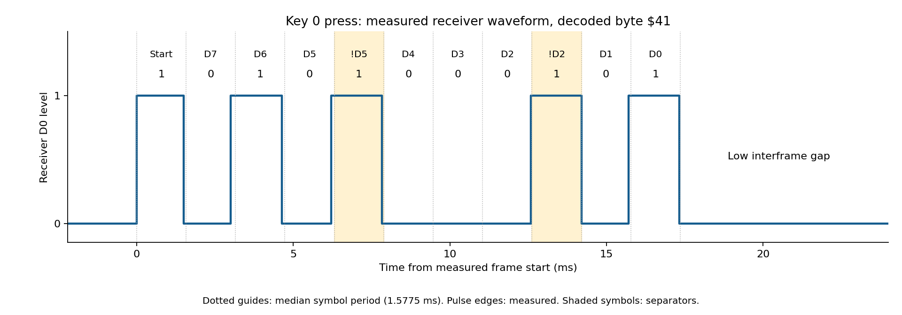

# Remote-control protocol: ROM-verified findings

This document treats the owner-supplied `Maxx Steele Personal Robot Remote
Control Protocol.txt` and `Remote Deep Dive.txt` as reference hypotheses.
The receiver decoder in the original ROM is authoritative for the findings
below. The subsequently supplied `Remote_caps.zip` contains real receiver-output
captures that independently confirm the framing and 23 key mappings below.
The remote's side jack has not yet been measured.

## Evidence and verification scope

The mapped ROM's SHA-256 is
`d6359ba53a5072ecf2e8703cecda8c63bb9a47c8f39cd07dd047089b2f2c1746`.
The default IRQ handler calls $FC6F at $FDCD on every interrupt, before its
eight-slot background-task dispatch. $FC6F–$FDC4 performs input decoding,
held-key tracking, and event queuing.

`tools/verify_remote.py` runs those original instruction bytes with py65 1.2.0,
feeding synthetic levels into bit 7 of $1400, one receiver call per simulated
interrupt. It verifies:

- All 25 press codes, including Power/Stop's nonlocal jump.
- Held repeats and matched releases for all 24 ordinary keys.
- All 256 possible decoded bytes: 64 satisfy the checksum and 192 fail it.
- Rejection of a malformed separator, timeout-generated release at 200 calls,
  two simultaneously active keys, and the stop path for a third active key.

See [verification results](remote-verification.json) and
[instruction trace for key 0](remote-first-key-trace.csv). The trace records
each executed PC/opcode, CPU registers, input level, decoder state, and mailbox.
The emulator intercepts the Power/Stop jump rather than running full startup.
It does not model the complete ASIC, RF hardware, CPU clock, or transmitter.
The real captures were also replayed through these original instruction bytes;
see the capture-validation section below.

## Input and sampling

The code directly establishes **$1400 bit 7** as the serial input:

- $FC96 uses `BIT $1400` / `BPL` to detect a high start level.
- $FCFD samples that bit into carry and `ROL $64` accumulates it.
- $FCB5 reads it during separator handling using two `ROL A` instructions.
  The second rotation places the original bit 7 in bit 0; this is still the
  same input, not a separate bit-6 signal.

There is no evidence here that $1400 is a standard VIA register. It is an
ASIC register whose other bit functions and decode aliases remain unresolved.

State $63 = 0 waits for two consecutive high samples. $62 counts sampling
calls. Ordinary data states sample when the counter equals 2, then reset it,
which gives three calls between ordinary data samples. States 4 and 8 instead
check an opposite-level separator relative to the last sampled data bit.
Their edge-handling logic can wait or reject malformed timing; it is not
ordinary fixed-baud UART framing.

The captures establish transmitter symbol and repeat timing. They do not
establish the actual IRQ rate. An IRQ call count must not be presented as a
measured hardware interval.

## Accepted logical frame

The state sequence shifts eight data bits, most significant first, in states
1, 2, 3, 5, 6, 7, 9, and 10. States 4 and 8 handle separators and do not add
payload bits. A synthetic sequence accepted by the original decoder is:

```text
S  D7 D6 D5  !D5  D4 D3 D2  !D2  D1 D0
1  checksum  release     key identifier
```

Here `S` is a high start symbol and `!D5` / `!D2` are opposite-level
separators. The data byte itself is:

```text
bit:   7 6       5          4 3 2 1 0
       checksum  release    key identifier
```

This is **11 logical symbols carrying an 8-bit code**, not the references'
claimed 12-bit frame carrying an 11-bit payload. This framing is now confirmed
in the real captures. The synthetic replay uses three receiver calls per symbol
and six low idle calls between frames; those synthetic gaps are not the measured
transmitter gaps. The receiver captures show low idle and roughly 1.58 ms
symbols. Jack-to-receiver polarity remains to be established.

## Checksum and event encoding

Let `key_id` be the one-based key identifier and `release` be 0 for press/held
or 1 for release:

```text
data = key_id | (release << 5)
checksum = popcount(data & $3F) modulo 4
code = data | (checksum << 6)
```

$FD28–$FD42 extracts bits 7–6, counts the set bits in bits 5–0, masks that
count to two bits, and compares it with the extracted checksum. A failure
increments $A1. The top bits are a population-count checksum, not command
groups. This is neither CRC nor the references' checksum-free protocol.

For ordinary presses, the decoder retains the complete code for repeat
detection and queues `key_id - 1`. For matched releases, it queues
`$20 + key_id - 1`. $FD93 implements the subtraction using `CLC; ADC #$FF`.
$FDAF–$FDC4 moves queued events into mailbox $75 when its high bit is set.
$80 is the normal no-event sentinel. $E6A4 copies available events into $15
and restores $75 to $80.

Thus `$75 = (payload | $20)` is incorrect. Ordinary press events are $00–$17,
and their release events are $20–$37. The key's behavior also depends on the
robot's current mode; a receiver event is not itself a motor command.

## Key mapping

Order follows the numbered keys, owner photo/manual labels, and the firmware
dispatch table at $E6B5. Code acceptance and event values were replayed through
the ROM. The real captures confirm all table entries except Lamp and Power/Stop;
those two remain ROM-derived predictions awaiting their own captures. Capture
`B.sr` confirms Home, matching the B label on the remote photograph.

| Key / primary label | ID | Press byte | Release byte | Press event |
|---|---:|---|---|---|
| 0 / Drive left | 1 | $41 | $A1 | $00 |
| 1 / Drive forward | 2 | $42 | $A2 | $01 |
| 2 / Drive reverse | 3 | $83 | $E3 | $02 |
| 3 / Drive right | 4 | $44 | $A4 | $03 |
| 4 / Wrist up | 5 | $85 | $E5 | $04 |
| 5 / Wrist down | 6 | $86 | $E6 | $05 |
| 6 / Arms up | 7 | $C7 | $27 | $06 |
| 7 / Arms down | 8 | $48 | $A8 | $07 |
| 8 / Claw rotate | 9 | $89 | $E9 | $08 |
| 9 / Claw open-close | 10 | $8A | $EA | $09 |
| Lamp | 11 | $CB | $2B | $0A |
| Home | 12 | $8C | $EC | $0B |
| Wait / Note rest | 13 | $CD | $2D | $0C |
| Shift octave | 14 | $CE | $2E | $0D |
| Clear | 15 | $0F | $6F | $0E |
| Enter | 16 | $50 | $B0 | $0F |
| Song / Notes | 17 | $91 | $F1 | $10 |
| Clock / Status | 18 | $92 | $F2 | $11 |
| Speech | 19 | $D3 | $33 | $12 |
| Motion / Back step | 20 | $94 | $F4 | $13 |
| Game | 21 | $D5 | $35 | $14 |
| Program | 22 | $D6 | $36 | $15 |
| Learn | 23 | $17 | $77 | $16 |
| Execute | 24 | $98 | $F8 | $17 |
| Power / Stop | 25 | $D9 | $39 | Special stop path |

The special $D9 press at $FD75 branches to $FD8E and jumps through $007A,
normally to immediate-mode entry $E0CB. It is not queued as ordinary event
$18. A nominal release byte $39 passes checksum validation, but Power/Stop is
not installed as a tracked held key, so an unmatched release produces no event.

For example, key 0 has press byte $41 (`01000001`) and accepted logical symbols
`10101000101` ($545). Its release byte is $A1 (`10100001`). Held repeats use
the same press code and refresh its age without queuing another press.

## Held keys, repeat handling, and timeouts

Two active-key slots are maintained. At $FD11–$FD1F a received byte matching
either slot refreshes that slot's age and the inactivity counters; this is
held-repeat handling, not a requirement for a second frame before accepting
a first press. A valid first press is delivered immediately.

Releases use bit 5 and match the low five-bit identifier of an active slot
($FD49–$FD70). Unmatched releases are ignored. The age scan at $FC71–$FC89
generates a release when a slot reaches $C8 (200 receiver calls) without refresh.
The duration in seconds remains unknown. A third new active key increments
$A2 and takes the same nonlocal mode/stop jump; it is not merely queued.

| RAM | Role |
|---|---|
| $62 | Receiver sampling/edge counter; temporary checksum extraction |
| $63 | Receiver state, 0–10 |
| $64 | Shift accumulator; bit 7 also used temporarily during separators |
| $65 / $68 | Full held-key code for slots 0 / 1 |
| $66 / $69 | Active one-based identifier for slots 0 / 1; zero means free |
| $67 / $6A | Slot ages; $FF marks inactive |
| $6B–$6E | Four-byte event ring |
| $6F / $70 | Producer / consumer ring indices, moving downward with wrap |
| $73 / $74 | Inactivity counters refreshed by tracked repeats |
| $75 | Event mailbox, normally $80 when empty |
| $A1 | Framing/checksum error counter |
| $A2 | No-free-active-slot error counter |

## Real capture validation

The owner supplied `Remote_caps.zip`, containing 23 sigrok `.sr` recordings,
matching PulseView `.pvs` settings, and a receiver wiring note. Each recording
has 500,000 one-byte logic samples at a metadata rate of **1 MHz**, covering
0.5 seconds. D0 is labeled Remote; its sample bit 0 is the receiver signal.
The wiring note reads `Green GND`, `Blue Signal`, `Gray 5V`. This identifies
the capture connection, not the remote's computer jack or measured logic rails.

Two independent processing paths were compared:

1. Run-length decoding of the captured edges into symbols, checking both
   separators, rebuilding the eight-bit code, and checking its population count.
2. Replay of the original D0 samples through the original ROM receiver decoder
   at a selected 528 microsecond sampling interval, with the mailbox consumed
   after each receiver call.

**All 261 complete frames agree between the two paths**, in the same sequence.
Every capture yields its expected press and release events, with **zero framing,
checksum, or active-slot errors** in the ROM replay. The 528 microsecond interval
is an accepted replay setting, not a measurement of the real ASIC interrupt
period. Full application scheduling and transmitter-jack behavior are not modeled.

| Quantity | Capture-derived result |
|---|---|
| Nominal symbol period | Median 1.5775 ms, approximately 634 symbols/second |
| Normalized pulse-run timing | 1.459–1.763 ms per symbol across measured runs |
| Held press-frame repetition | Median 28.928 ms; measured range 28.872–28.984 ms |
| Nominal 11-symbol frame duration | Approximately 17.35 ms |
| Nominal remaining interframe time | Approximately 11.58 ms, low; final zero data symbols can merge with idle |
| Captured key count | 23 of the 25 known keys |
| Missing key captures | Lamp and Power/Stop |
| Incomplete tails | `9.sr` and `MOTION.sr`; recorded separately, not counted as complete frames |

The symbol-period estimate normalizes each non-idle run by its nearest integer
symbol count using a 1,580 microsecond reference. It is an approximate measured
timing summary, not proof of oscillator accuracy. Some recordings contain more
than one press/release episode; they should not be forced into a single-tap
interpretation. The capture metadata's sample-clock calibration is not known.



This plot shows an actual repeated press frame from `0.sr`. The dotted guides
use the median symbol period; the pulse edges come from the capture. An
[SVG version](remote-key0-waveform.svg) is also available.

See [capture report](remote-capture-verification.json),
[all decoded frames](remote-capture-frames.csv), and
`tools/replay_remote_captures.py` for reproducible evidence. The report records
the archive hash, per-key code counts, event times, and incomplete tails.

## Reference claims that should not be used for a transmitter

- The group fields and the proposed 6×6 scan matrix are not supported by this
  decoder. It receives key identifiers with checksum and release information;
  the remote's actual internal matrix needs its own hardware or firmware evidence.
- Several reference binary strings disagree with their hexadecimal labels.
  For example, the string for key 6 is $617, not the listed $605.
- The reference claims $E6B5 contains a simple $00–$18 progression. Actual bytes
  are `00 01 02 03 04 05 06 07 08 09 0A 0B 0C 0D 0E 0F 41 46 43 13 84 82 81 83 80`.
- $E5EC is used for operand bounds, not the reference's asserted sparse key map.
- Press/held repetition refreshes a key; it is not the checksum mechanism.
- Sending the references' strings as-is is unsafe as a control specification:
  in exploratory replay, the string labeled Clear yielded event $01 and the
  string labeled Enter yielded event $03 under the chosen synthetic timing.
  These tests do not reproduce an original physical capture.

## Completing computer control through the remote jack

The owner reports that the side jack bypasses the remote CPU and directly
drives the transmitter. The robot ROM can establish accepted receiver codes,
but cannot establish that jack's pinout or electrical requirements.

The next hardware evidence should be:

1. Jack pinout, signal reference, voltage levels, polarity, and loading, traced
   to the transmitter input. Determine whether insertion changes any wiring.
2. Missing receiver captures for Lamp and Power/Stop, plus a two-key capture.
   The supplied captures already establish the other 23 keys and press/release
   framing at the receiver.
3. Simultaneous transmitter-input and receiver-output captures to establish
   the jack-to-receiver polarity and any transmitter modulation transformations.
4. Actual IRQ/sample-rate measurement. Receiver-side symbol widths, repeat
   cadence, and approximate gaps are now available above.

Then a computer interface can generate press, periodic held-repeat, and matched
release frames through suitable level translation. It must support Power/Stop's
special behavior and avoid overrunning the small event ring. A standard UART
configuration or the references' approximate kHz/100 ms timing is not yet a
verified jack implementation. The receiver-side waveform gives a practical
target once the electrical mapping is established.

## Reproduce the ROM checks

```sh
python3 -m venv /workspace/.venvs/maxx-steele
/workspace/.venvs/maxx-steele/bin/python -m pip install py65==1.2.0
cd /workspace/Maxx_Steele
/workspace/.venvs/maxx-steele/bin/python tools/verify_remote.py \
  --rom /path/to/Maxx_Steele_Main_Mapped.bin \
  --report /tmp/remote-verification.json \
  --trace /tmp/remote-first-key-trace.csv
```

The script requires the exact known ROM hash and raises on any failed check.
The saved report's press-symbol strings are useful replay fixtures, not measured
jack waveforms.

To reproduce the real-capture validation from the same working directory:

```sh
/workspace/.venvs/maxx-steele/bin/python tools/replay_remote_captures.py \
  --archive /path/to/Remote_caps.zip \
  --rom /path/to/Maxx_Steele_Main_Mapped.bin \
  --report /tmp/remote-capture-verification.json \
  --frames /tmp/remote-capture-frames.csv
```
